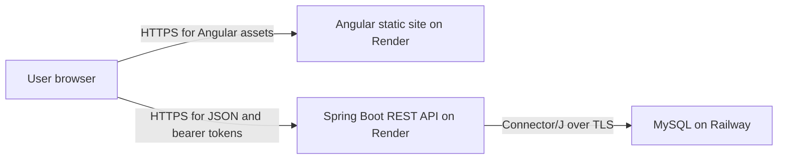

# Olympic Nutrition Tracker Backend

Olympic Nutrition Tracker helps athletes and coaches track nutrition and consultations. This Spring Boot REST API manages athlete profiles, coach assignments, consultation schedules, and nutrition entries for the [Angular application](https://github.com/eman-java-dev/olympic-nutrition-tracker-frontend).

[Live frontend](https://olympic-nutrition-tracker-frontend.onrender.com) · [Live API health check](https://olympicnutritiontracker-backend.onrender.com/healthz)

## Architecture



The API uses Java 21, Spring Boot 4.1.2, Spring Security 7.1.2, and Spring Data JPA with Hibernate. MySQL is the application database and MySQL Connector/J 9.7.0 is the JDBC driver. Authentication uses BCrypt password hashing and signed JWTs via JJWT 0.13.0. The build uses Maven Wrapper with Maven 3.9.11. The [Maven manifest](pom.xml) declares Spring Boot’s dependency management and springdoc OpenAPI 3.2.0.

## Authentication and authorization

Send `username` and `password` to `POST /api/auth/login`. On success the API returns `token`, `username`, and `role`. For protected requests, send `Authorization: Bearer <token>`. Spring Security validates the token’s signature and expiry and reloads the account and its authorities from the database on each authenticated request.

Public registration always creates an `ATHLETE` account. Privileged accounts and athlete or coach profile links are provisioned by a trusted operator. An unlinked account has no athlete-scoped records.

| Role | Access |
| --- | --- |
| `ADMIN` | Create, read, update, and delete athletes, coaches, consultations, and nutrition entries. Assign coaches to athletes. |
| `COACH` | Read the coach directory, assigned athletes, and their nutrition entries. Create and update nutrition entries for assigned athletes. Read, create, and update consultations for assigned athletes under the coach’s own profile. |
| `ATHLETE` | Read the linked athlete profile, its nutrition entries and consultations, and the coach directory. |

A missing or invalid bearer token yields HTTP `401` on protected routes. An authenticated request can receive `403` if an operation is forbidden or `404` if a record is unavailable within the caller’s scope.

## API reference

| Resource | Methods and routes |
| --- | --- |
| Authentication | `POST /api/auth/register`, `POST /api/auth/login` |
| Athletes | `GET /api/athletes`, `POST /api/athletes`, `GET /api/athletes/{id}`, `PUT /api/athletes/{id}`, `DELETE /api/athletes/{id}` |
| Coach assignment | `PUT /api/athletes/{athleteId}/assign-coach/{coachId}` |
| Coaches | `GET /api/coaches`, `POST /api/coaches`, `GET /api/coaches/{id}`, `PUT /api/coaches/{id}`, `DELETE /api/coaches/{id}`, `GET /api/coaches/{coachId}/athletes` |
| Consultations | `GET /api/consultations`, `POST /api/consultations`, `GET /api/consultations/{id}`, `PUT /api/consultations/{id}`, `DELETE /api/consultations/{id}` |
| Nutrition entries | `GET /api/nutrition-entries`, `POST /api/nutrition-entries`, `GET /api/nutrition-entries/{id}`, `PUT /api/nutrition-entries/{id}`, `DELETE /api/nutrition-entries/{id}` |
| Diagnostics | `GET /api/db-check` requires `ADMIN` and is available outside the `prod` profile. |
| Health on the deployed branch | `GET /healthz` and `GET /health` are public liveness checks at `7380bcd`. They return HTTP `200` without querying MySQL. |

Paginated collections accept Spring Data’s `page`, `size`, and `sort` parameters. Add `?search=<name>` to search coaches by name, or `?athleteId=<id>` to filter nutrition entries within the caller’s scope. Swagger UI is available locally at `http://localhost:8080/swagger-ui/index.html`. Swagger UI and OpenAPI are disabled under `prod`.

## Local development

Install a Java 21 JDK and MySQL 8. Prepare a local schema with the application tables before starting Spring Boot. Hibernate validates the existing schema and automatic SQL initialization is disabled. The [isolated demo runbook](deploy/exam-demo/README.md) prepares a local schema and synthetic accounts. The [deployment runbook](deploy/README.md) explains when an older schema needs the account-profile migration.

Set these variables in the process environment or IDE run configuration. Keep credentials and signing material outside Git.

| Variable | Local value or purpose |
| --- | --- |
| `SPRING_DATASOURCE_URL` | `jdbc:mysql://127.0.0.1:3306/<LOCAL_SCHEMA>` |
| `SPRING_DATASOURCE_USERNAME` | `<LOCAL_DB_USER>` |
| `SPRING_DATASOURCE_PASSWORD` | `<LOCAL_DB_PASSWORD>` |
| `JWT_SECRET` | `<BASE64_SIGNING_KEY>`, generated from at least 32 random bytes |
| `JWT_EXPIRATION_MS` | Optional token lifetime in milliseconds. The default is 24 hours. |
| `CORS_ALLOWED_ORIGINS` | Comma-separated exact origins. The local defaults are `http://localhost:4200` and `http://127.0.0.1:4200`. |
| `PORT` | HTTP port, default `8080`. |

Start the API from the repository root:

```powershell
.\mvnw.cmd spring-boot:run
```

On macOS or Linux, use `./mvnw spring-boot:run`. Follow the [frontend installation instructions](https://github.com/eman-java-dev/olympic-nutrition-tracker-frontend) to start Angular.

## Tests

```powershell
.\mvnw.cmd verify
```

On macOS or Linux, use `./mvnw verify`. The suite covers service operations, consultation HTTP mappings, context startup, registration and login, bearer-token rejection, role and record-level access, and the Angular CORS preflight. Integration tests use embedded H2 and synthetic records. They do not exercise the Railway database or validate the deployment’s TLS configuration.

## Render and Railway

The [Dockerfile](Dockerfile) runs Maven verification in a Java 21 build stage and launches the JAR as a non-root user with the `prod` profile. Render supplies `PORT`. Set the exact frontend HTTPS origin in `CORS_ALLOWED_ORIGINS` and keep database credentials and the JWT signing key in the backend service configuration.

The production TLS settings are branch-specific:

| Revision | JDBC and TLS configuration |
| --- | --- |
| `master` at `58443be` | Set `SPRING_DATASOURCE_URL` to `jdbc:mysql://<HOST>:<PORT>/<SCHEMA>`. The profile uses `VERIFY_IDENTITY`. The MySQL server certificate must chain to a trusted CA and identify `<HOST>`. See the [master deployment runbook](deploy/README.md). |
| Render deployment at `7380bcd` | The deployment branch builds the JDBC URL from `MYSQL_HOST`, `MYSQL_PORT`, and `MYSQL_DATABASE`. It uses `VERIFY_CA` with a dedicated PKCS#12 truststore supplied through `MYSQL_TLS_TRUST_STORE_BASE64` and `MYSQL_TLS_TRUST_STORE_PASSWORD`. Use `/healthz` for the HTTP liveness probe. See the [deployed revision’s runbook](https://github.com/eman-java-dev/OlympicNutritionTracker-Backend/blob/7380bcde0eae979d5ad2bc1cce1e5d9cd3aeaa34/deploy/README.md). |

Railway’s TCP proxy forwards the MySQL connection. The deployment branch verifies the server’s certificate chain without verifying the proxy hostname. Moving to `VERIFY_IDENTITY` requires a trusted MySQL certificate that covers the hostname used in the JDBC URL. [Connector/J TLS modes](https://dev.mysql.com/doc/connector-j/en/connector-j-connp-props-security.html)

## Current limits

Account provisioning and profile linking require an operator. The API has no refresh-token, password-reset, or email-verification flow. MySQL integration testing, browser end-to-end coverage, and hostname verification for the deployed MySQL connection remain separate follow-up work.
